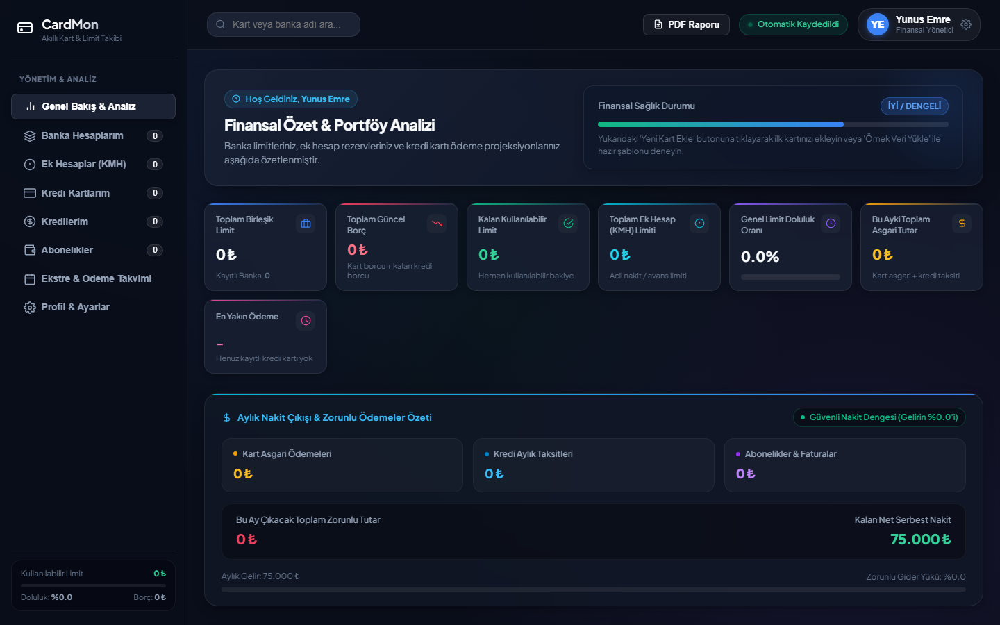
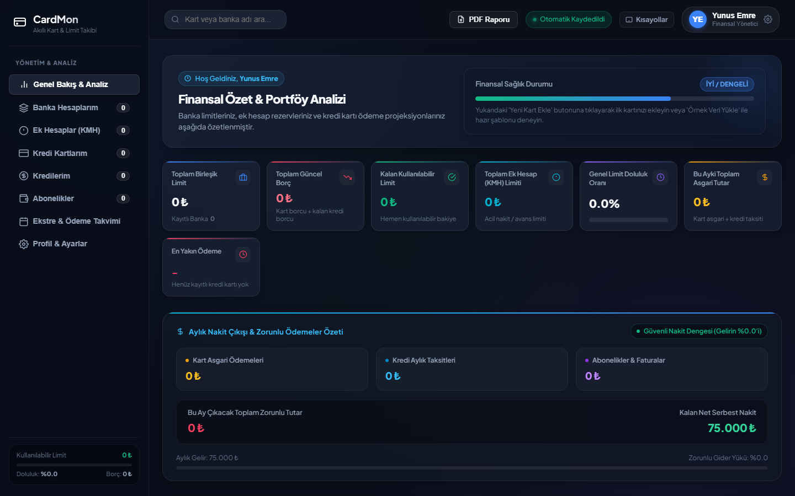

# CardMon

<!-- aegean:media:start -->
<p align="center"></p>
<p align="center"><a href="LICENSE"></a> <a href="https://github.com/AegeanWorks/AIKit"></a></p>
<!-- aegean:media:end -->


Smart bank and credit card portfolio manager for tracking limits, debt balances, installments, payment schedules, and native file system storage (.cardmon).

## ⚡ 30-Second Cold-Start Quick Reference

- **Runtime Prerequisites**: Modern web browser (Chrome, Edge, Firefox, Safari) or Node.js >=20.0.0
- **Canonical Regression Shield Gate**:
  ```bash
  npm test
  ```

### 🛠️ AIKit Commands (run from the AIKit folder)
| Role | Command |
|---|---|
| Status, task and gates | `python aikit.py status CardMon` |
| Phase 4: every gate | `python aikit.py check CardMon` |
| Repair memory and map, then check | `python aikit.py fix CardMon` |
| Resume an interrupted task | `python aikit.py resume CardMon` |

## 📦 What's Inside

```text
CardMon/
├── .aikit/                   <- this project's memory: record, ledger, decisions
├── .gitattributes            <- LF-on-checkout, ledger merge drivers, binary assets
├── .gitignore                <- transient AIKit state excluded
├── COMMERCIAL.md             <- commercial license terms
├── LICENSE                   <- project license (AL-1.1)
├── LICENSES/                 <- reuse license specifications
├── README.md                 <- cold-start reference and documentation
├── REUSE.toml                <- license metadata
├── assets/                   <- branding and visual assets
├── css/                      <- modular stylesheet design system
├── i18n.js                   <- internationalization and currency formatting
├── index.html                <- application interface and layout
├── apk.html                  <- phone-friendly standalone APK build/download page
├── js/                       <- modular application logic and domain handlers
│   ├── backup-vault.js
│   ├── constants.js
│   ├── en-overlay.js         <- English overlay for legacy hard-coded labels
│   ├── file-system.js
│   ├── main.js
│   ├── modals.js
│   ├── reports.js
│   ├── smart-advisor.js
│   ├── state.js
│   ├── apk-page.js           <- logic for the standalone APK page
│   ├── sync-client.js        <- local sync client used by the web app
│   ├── utils.js
│   └── views.js
├── server/                   <- zero-dependency local sync + APK build server
├── android/                  <- Android WebView companion app (Gradle project)
├── dist/                     <- built APK output (generated by the build function)
├── package.json              <- npm package manifest and test scripts
├── start-server.cmd          <- one-click Windows server starter
├── start-server.sh           <- one-click macOS/Linux server starter
├── create-desktop-shortcut.cmd <- creates the "CardMon Server" desktop button
├── allow-firewall.cmd        <- opens TCP sync + UDP discovery ports (admin)
├── network-check.cmd         <- diagnoses "connection refused" on the phone
├── styles.css                <- stylesheet aggregator entrypoint
└── tests/                    <- unit and integration test suite
```

## 📱 Local Sync & Android App

CardMon can host the web app on your LAN and keep the portfolio in sync with an
Android companion app. No cloud service and no third-party runtime dependencies
are required.

**Sync is manual by default.** The app discovers the server address on demand,
and the web app only uploads/downloads when you press a sync button. Nothing
syncs continuously in the background unless you explicitly turn on *Auto-sync*.

**One home per action.** The top-right user menu is the single place for
profile/settings and all file/backup/export actions (save, open, backup,
import/export JSON and CSV, PDF report, demo data, shortcuts, clear data). The
sidebar is navigation only, the profile modal contains only profile fields, and
the APK page has one launcher in the top bar. No action is duplicated across
menus.

**Public-release ready.** The source tree contains no personal names, private
IP addresses or machine identifiers. Profile defaults are generic, the LAN
discovery beacon publishes only the connection port and interface addresses,
and documentation examples use the RFC 5737 documentation range (`192.0.2.x`).
The contact address in the license files is the project licensor's public
business address, not personal data.

**English is the default UI language.** Turkish remains available from the
language selector in Profile & Settings. `js/en-overlay.js` translates legacy
hard-coded labels, runtime toasts and generated report text when English is
selected, and restores them on switch back. The standalone APK page and the
Android companion are English-only.

### 1. Start the local sync server

**One click (Windows):** double-click `start-server.cmd`. It starts the server
in a window that stays open and opens `http://localhost:8765/apk` in your
browser. The LAN/phone URL is printed in that window. For a permanent desktop
button, double-click `create-desktop-shortcut.cmd` once — it places a
**CardMon Server** shortcut on your Desktop. On macOS/Linux run
`./start-server.sh`. Set `CARDMON_PORT` to change the port (default `8765`).

Or from a terminal:

```bash
npm start
# or: node server/index.js --port 8765 --host 0.0.0.0
# optional: --token my-secret   (clients then send X-CardMon-Token)
```

The console prints the LAN address to enter in the Android app, for example
`http://192.0.2.10:8765`. The same server also serves `index.html`, so opening
that address in a browser gives you the full CardMon web app.

### 2. Phone auto-discovery (no IP typing)

The server listens passively on UDP `8766`. On first launch — or when you tap
**Sunucuyu Otomatik Bul** in the app — the Android companion sends **one**
broadcast and uses the HTTP port from the first reply. The server never
announces itself continuously and no background sync service runs. If discovery
fails (guest Wi-Fi / AP isolation), the address can still be entered manually.
Open UDP `8766` in the firewall with `allow-firewall.cmd` if needed.

### 3. Sync the web app

Open **Sync & Mobil** in the sidebar. Set the server address (it defaults to the
origin you are browsing from), optionally enter the access token, then use:

- **Test Connection** — checks `/api/health` and shows detected LAN addresses.
- **Push to Server** — uploads the current portfolio with an optimistic
  revision check (a newer server revision returns a 409 conflict).
- **Pull from Server** — downloads and applies the server portfolio.
- **Auto-sync** — pushes changes 1.5 s after a local save.
- **Force Push** — overwrites the server revision after a conflict.

Portfolios are stored atomically in `.sync-data/portfolio.json` with an
incrementing `revision` number.

### 4. Build the APK from the website

In the same **Sync & Mobil** panel, press **Build Android APK**. The server runs
the local Gradle/Android toolchain (`android/gradlew`, SDK detected from
`ANDROID_HOME` or `%LOCALAPPDATA%\Android\Sdk`) and exposes the result in
`dist/cardmon-debug.apk`. The **Download APK** link then serves that file
directly from the website. The same action is available from the shell:

```bash
npm run build:apk
```

**Directly from your phone browser** (no app install, no desktop UI needed):

1. Start the server; the console prints `Phone APK: http://<lan-ip>:<port>/apk`.
2. Open that link in the phone browser (or tap the **APK** button in the app top
   bar and use the standalone-page link).
3. Tap **Build APK / APK Oluştur** — the page polls `/api/build-apk/status`,
   shows live progress, then a **Download APK** button.
4. Tap download and allow "Install unknown apps" when Android asks.

The standalone page is served at `/apk` (aliases: `/build-apk`, `/apk.html`). It
stays public even when a sync token is configured; if the server requires a
token, enter it in the page's token field (remembered locally and sent with the
build, status and download requests).

Requirements: JDK 17+, Android SDK with platforms `android-35` and build-tools
`35.0.0` (already present on this machine), and Gradle 8.11.1 (the wrapper
downloads it on first use). If a toolchain component is missing, the status
panel reports a `Why:`/`Fix:` message instead of failing silently.

### API reference

| Method | Route | Purpose |
|---|---|---|
| `GET` | `/api/health` | Service state, revision, authentication requirement |
| `GET` | `/api/sync/info` | LAN addresses and detected Android toolchain |
| `GET` | `/api/portfolio` | Current portfolio + revision |
| `PUT` | `/api/portfolio` | Save portfolio; optional `baseRevision` for conflict detection |
| `POST` | `/api/build-apk` | Start an APK build job |
| `GET` | `/api/build-apk/status` | Poll the latest build job |
| `GET` | `/api/build-apk/download` | Download `cardmon-debug.apk` |

<!-- aegean:brand-assets:start -->
## 🎨 Brand Assets

> **AI-Generated Brand Artwork.** The banner and logo are **AI-generated brand assets**. They are illustrative and may not literally depict every feature or the full project scope.
<!-- aegean:brand-assets:end -->

## 📜 License

<!-- aegean:license:start -->
Free for personal use under the Aegean License 1.1 (AL-1.1); see [LICENSE](LICENSE). Any commercial use needs the Aegean Commercial License 1.0 (ACL-1.0); see [COMMERCIAL.md](COMMERCIAL.md).
<!-- aegean:license:end -->

<!-- aegean:screenshots:start -->
## Screenshots

<a href="https://github.com/AegeanWorks/CardMon/commit/f6adaf53e97c5f31ddfe832e3743cfa0ca8ff98a"></a>

*commit `f6adaf53e97c5f31ddfe832e3743cfa0ca8ff98a` · 2026-11-14*

<a href="https://github.com/AegeanWorks/CardMon/commit/03d327703d978b4283123e2b18d0c71cb18c99a1"></a>

*commit `03d327703d978b4283123e2b18d0c71cb18c99a1` · 2026-11-19*
<!-- aegean:screenshots:end -->
