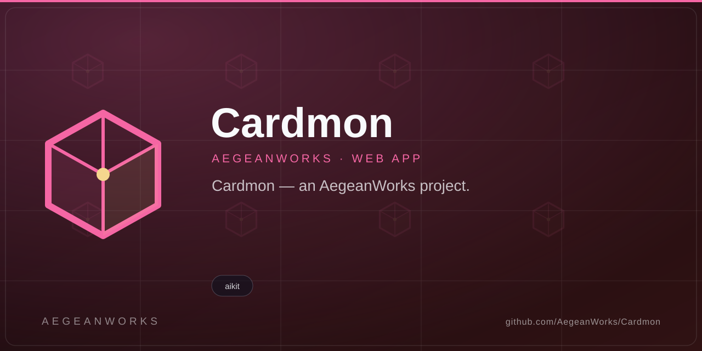

# CardMon

<!-- aegean:media:start -->
<p align="center"></p>
<p align="center"><a href="LICENSE"></a> <a href="https://github.com/AegeanWorks/AIKit"></a></p>
<!-- aegean:media:end -->


Smart bank and credit card portfolio manager for tracking limits, debt balances, installments, payment schedules, and native file system storage (.cardmon).

## ⚡ 30-Second Cold-Start Quick Reference

- **Runtime Prerequisites**: Modern web browser (Chrome, Edge, Firefox, Safari) or Node.js >=20.0.0
- **Canonical Regression Shield Gate**:
  ```bash
  npm test
  ```

### 🛠️ AIKit Commands (run from the AIKit folder)
| Role | Command |
|---|---|
| Status, task and gates | `python aikit.py status CardMon` |
| Phase 4: every gate | `python aikit.py check CardMon` |
| Repair memory and map, then check | `python aikit.py fix CardMon` |
| Resume an interrupted task | `python aikit.py resume CardMon` |

## 📦 What's Inside

```text
CardMon/
├── .aikit/                   <- this project's memory: record, ledger, decisions
├── .gitattributes            <- LF-on-checkout, ledger merge drivers, binary assets
├── .gitignore                <- transient AIKit state excluded
├── COMMERCIAL.md             <- commercial license terms
├── LICENSE                   <- project license (AL-1.1)
├── LICENSES/                 <- reuse license specifications
├── README.md                 <- cold-start reference and documentation
├── REUSE.toml                <- license metadata
├── assets/                   <- branding and visual assets
├── css/                      <- modular stylesheet design system
├── i18n.js                   <- internationalization and currency formatting
├── index.html                <- application interface and layout
├── js/                       <- modular application logic and domain handlers
├── package.json              <- npm package manifest and test scripts
├── styles.css                <- stylesheet aggregator entrypoint
└── tests/                    <- unit and integration test suite
```

<!-- aegean:brand-assets:start -->
## 🎨 Brand Assets

> **AI-Generated Brand Artwork.** The banner and logo are **AI-generated brand assets**. They are illustrative and may not literally depict every feature or the full project scope.
<!-- aegean:brand-assets:end -->

## 📜 License

<!-- aegean:license:start -->
Free for personal use under the Aegean License 1.1 (AL-1.1); see [LICENSE](LICENSE). Any commercial use needs the Aegean Commercial License 1.0 (ACL-1.0); see [COMMERCIAL.md](COMMERCIAL.md).
<!-- aegean:license:end -->

<!-- aegean:screenshots:start -->
## Screenshots

<a href="https://github.com/AegeanWorks/CardMon/commit/f6adaf53e97c5f31ddfe832e3743cfa0ca8ff98a"></a>

*commit `f6adaf53e97c5f31ddfe832e3743cfa0ca8ff98a` · 2026-11-14*

<a href="https://github.com/AegeanWorks/CardMon/commit/03d327703d978b4283123e2b18d0c71cb18c99a1"></a>

*commit `03d327703d978b4283123e2b18d0c71cb18c99a1` · 2026-11-14*
<!-- aegean:screenshots:end -->
